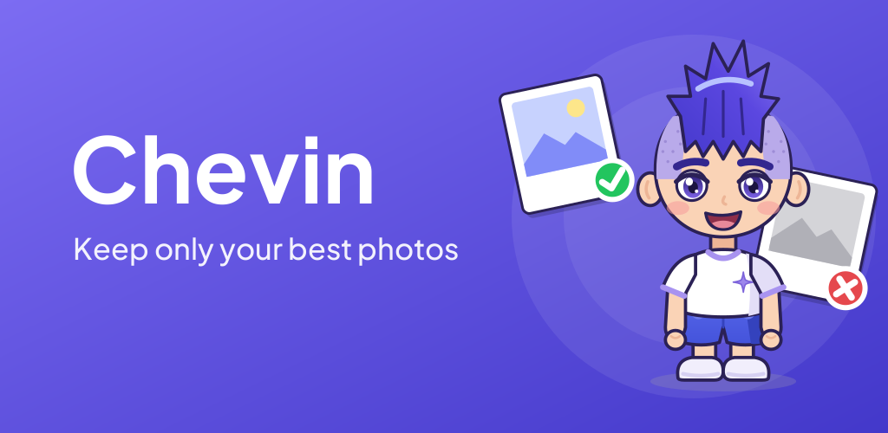
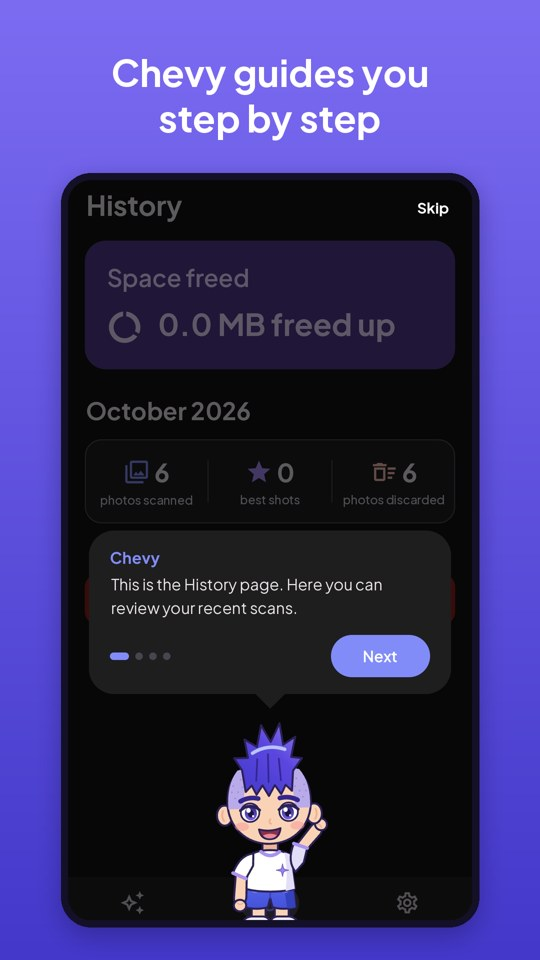
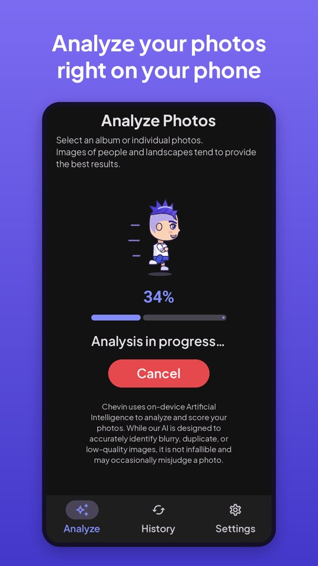
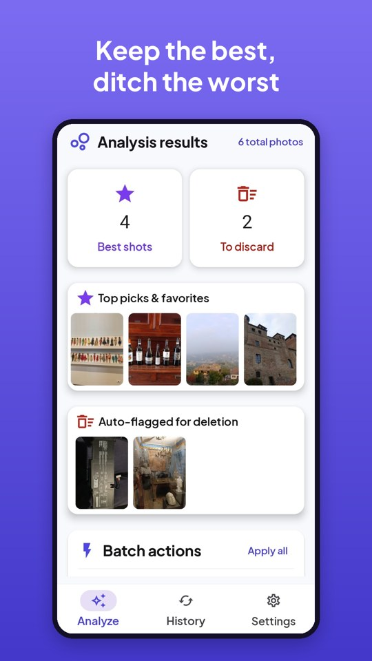
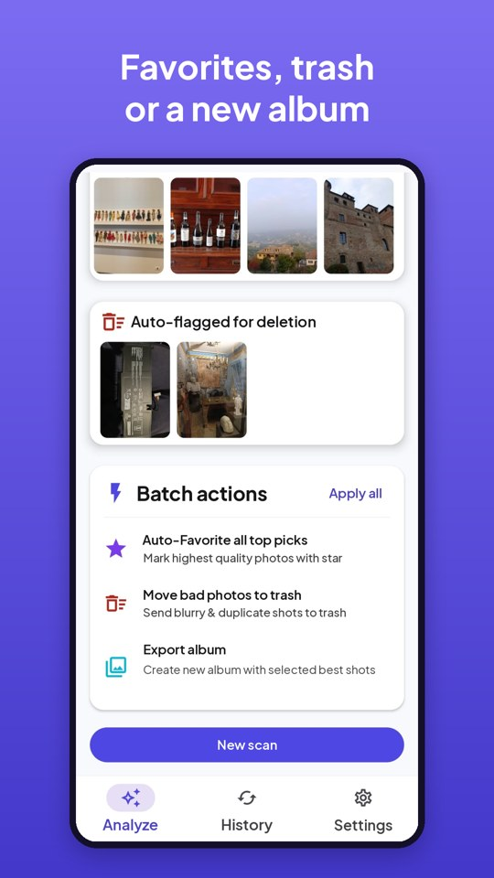
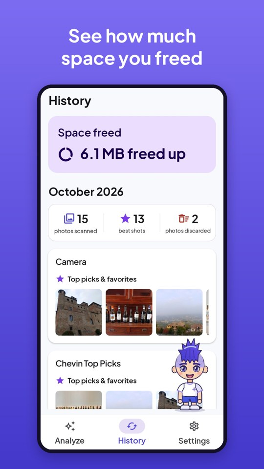
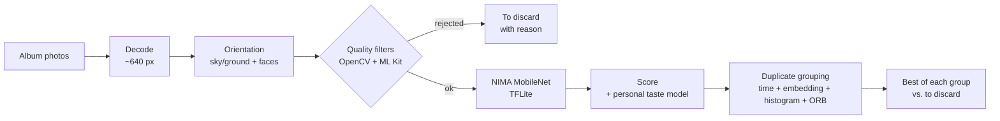

  

# Chevin – AI photo cleaner for Android

**Chevin** finds the blurry, dark and duplicate photos in your gallery and suggests which ones to keep, using AI models that run **entirely on the phone**. Pick an album, start the scan, and Chevy – the app's mascot – walks you through the results.

> **Status:** in closed testing on Google Play (October 2026). Public release coming soon.
>
> The source code is private. This repository is a showcase of the project: features, architecture and tech stack. Happy to walk through the code in an interview.

  
  
  
  
  

## Features

- **Quality filters** – detects blurry and shaky shots, dark obstructions (a finger on the lens), overexposed and out-of-focus close-ups.
- **Duplicate grouping** – groups near-identical shots taken in a short time window and keeps the best one of each group.
- **Aesthetic score** – rates every photo with a NIMA (Neural Image Assessment) model based on MobileNet.
- **Learns your taste** – every time you move a photo between "Best shots" and "To discard", a small on-device model is retrained and adjusts future scores.
- **Batch actions** – add the best shots to favorites, move the rest to the system trash (recoverable for 30 days) or export them to a new album.
- **Privacy by design** – no account, no server: photos never leave the device. Supports Android 14 partial photo access.
- **Polish** – animated mascot drawn in vector with Compose Canvas, dark theme, 4 languages (EN, IT, ES, FR), background analysis with progress notification, cancel button and thermal throttling.

## How the analysis works

1. **Decode** – each photo is decoded already downscaled, one at a time, to keep memory low on albums with thousands of photos.
2. **Orientation** – a heuristic on sky/ground bands plus face detection at 90°/270° straightens rotated photos before analysis.
3. **Quality filters** – Laplacian variance per block (sharpness), flat-area and skin-tone ratios (smudges, fingers, too-close shots), dark/white pixel ratios (obstructions, overexposure). ML Kit Face Detection relaxes the blur threshold for portraits.
4. **Aesthetic model** – NIMA on MobileNet (TensorFlow Lite) returns a 1–10 score and a 1024-d embedding.
5. **Personal taste** – a logistic-regression model on the embedding, trained on the device from the user's corrections, shifts the final score by up to ±1.5.
6. **Duplicate grouping** – consecutive photos within a time window are merged when their centered embeddings, thumbnails and HSV histograms are similar; ORB keypoint matching confirms borderline cases. The highest-scoring photo of each group is kept.

## Tech stack

| Area | Technologies |
| --- | --- |
| Language & UI | Kotlin, Jetpack Compose, Material 3, Navigation Compose |
| Architecture | MVVM, Hilt (DI), Kotlin Coroutines & Flow |
| Storage | Room, DataStore |
| On-device AI | TensorFlow Lite (NIMA / MobileNet), Google ML Kit Face Detection |
| Computer vision | OpenCV (Laplacian, histograms, ORB feature matching) |
| Android platform | Foreground service (`mediaProcessing`), MediaStore trash / favorite requests, partial photo access, per-app language, thermal API |
| Quality | JUnit unit tests (scoring, taste model, clustering), Room instrumented tests, R8 / ProGuard |
| Release | Signed Android App Bundle, Google Play closed testing |

## Team

Built by **[Alex Martinelli](https://github.com/alex-martinelli)** and **[Giovanni](https://github.com/Giovanni188)**.

| | Role |
| --- | --- |
| **Alex Martinelli** | **AI and image analysis.** Designed and built the whole analysis pipeline: quality filters with OpenCV, face-aware blur thresholds with ML Kit, automatic orientation, NIMA aesthetic model conversion and integration in TensorFlow Lite, scoring, the on-device personal taste model, and duplicate grouping with embeddings, histograms and ORB matching. |
| **Giovanni** | **App architecture and UI.** Designed the app structure and logic (MVVM, navigation, data layer) and the user interface in Jetpack Compose. |

## Credits

NIMA weights from [idealo/image-quality-assessment](https://github.com/idealo/image-quality-assessment) (Apache 2.0) · Font: Plus Jakarta Sans (SIL OFL 1.1) · Sound effects from Pixabay.
